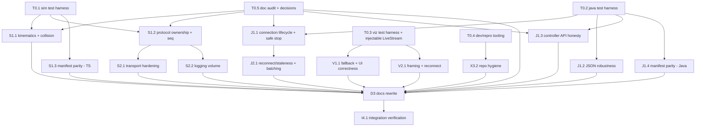

# Pre-feature hardening plan

**Status:** agreed scope, ready for agent orchestration
**Owner:** human reviewer (merge gates) + one agent per task below
**Last updated:** 2026-11-17

## Purpose

The MVP works, but it grew two generations of features while its docs, safety
claims and a few physics/lifecycle details stayed in "iteration 1". This plan
is the single source of truth for the hardening pass that must land **before
any new features**. It is deliberately written so that an individual agent can
pick up one task, work only inside its declared file list, and know exactly
when it is done.

`AGENTS.md` is still useful as an architecture overview, but **where it
conflicts with this document, this document wins**. The conflict will be
resolved in task `D3.c`.

### Ground rules for every agent

1. Read `HARDENING_PLAN.md` and `docs/DECISIONS.md` (produced by `T0.5`) before
   editing. Do not re-litigate the decisions; implement them.
2. Touch **only** the files listed as exclusive ownership for your task. If you
   need a file owned by another task, note it in your final report instead.
3. Do not add features. No new message types, behaviours, sensors, UI controls
   or config options beyond what a task explicitly asks for.
4. Do not change the NDJSON envelope shape (`type`, `seq`, `simTick`, `payload`)
   without updating the matching spec in the same wave.
5. Several target files are **currently modified in the working tree**
   (`AGENTS.md`, root `package.json`, `scripts/dev.js`,
   `robot-framework/README.md`, `RobotController.java`). Those are the user's
   in-flight edits. Preserve them; make targeted edits only.
6. Every task ends with its verification commands. A task is not done until
   they pass and the diff is reviewed at the merge gate.

---

## Agent dispatch prompt

Do **not** rely on `AGENTS.md` to point agents at this plan. Every agent prompt
must carry the pointer itself. Copy the block below verbatim, replacing
`<TASK_ID>` and `<PLAN_PATH>` (use the absolute path to the plan in that
agent's own worktree if you dispatch into worktrees).

> You are working in the oobot repository at `/Users/ant/repos/oobot`.
>
> **Before you do anything else, read `<PLAN_PATH>` in full**, then read
> `docs/DECISIONS.md` (produced by `T0.5`). If `docs/DECISIONS.md` does not yet
> exist, use the "Decisions locked in" table in the plan — it is authoritative.
>
> Your assigned task is **`<TASK_ID>`**. Its entry in the plan is your complete
> specification: exclusive file ownership, steps, acceptance criteria and
> verification commands. `AGENTS.md` is context only; where it conflicts with
> the plan, the plan wins.
>
> Rules:
>
> - Work only inside the files owned by `<TASK_ID>` in the plan's File ownership
>   table. If you need to change a file owned by another task, do not change it
>   — report it as a coordination note instead.
> - Several files have in-flight user edits; the plan flags them. Preserve them.
> - Follow the locked decisions. Do not re-decide them; report objections.
> - No new features, no new message types, no speculative refactors.
> - Run every verification command listed in your task and report raw results.
>
> Final report must contain: (1) each acceptance criterion and whether it is
> met, (2) commands run and outcomes, (3) files changed, (4) coordination notes
> or blockers, (5) anything deliberately left undone.
>
> **Do not commit.** The merge-gate owner reviews the diff.

### Orchestrator notes

1. Commit this plan before creating agent worktrees, so every worktree has an
   identical copy and `<PLAN_PATH>` resolves inside each one.
2. Dispatch one agent per task in the wave table. Check the ownership table
   before dispatch; never put two agents on the same file in one wave.
3. At each merge gate: run **all** verification commands from every task in the
   wave, then `git diff --check`, then review before merging. Failure sends the
   task back to its agent; do not let later waves start on a red gate.
4. `T0.5` must land before W1 agents start, since they depend on the decision
   record and fixture specification.

## Decisions locked in (see `T0.5` for the record)

| ID | Decision | Why |
|----|----------|-----|
| **D-1** | Kinematics: keep the world scale, introduce `WORLD_UNITS_PER_METRE = 100`. Convert wheel speeds to m/s before computing angular velocity; remove the independent `maxAngularSpeed` clamp. `linear = (v_l+v_r)/2 * UNITS`, `angular = (v_r-v_l)/trackWidth` with `v = power * maxSpeed / UNITS`. With defaults (`maxSpeed=100`, track `0.5`) full differential = 4 rad/s ≈ 229°/s, proportional to input. | Preserves manifest offsets and behaviour thresholds, makes the manifest-derived track width actually matter, removes bang-bang turning. |
| **D-2** | Safe-stop is a **two-layer contract**: (a) sim stops motors on robot socket close; (b) Java sends an explicit zero command *before* closing/reconnecting. Both must work independently. | The current Java "safe stop" is a no-op because it sends after `open=false`. |
| **D-3** | For this pass, keep fixed sensor ids `front-sensor` / `right-sensor` in `Brain`, but **document the constraint honestly** and fail with a clear message. Do not pretend the API is fully generic. | Making it truly generic is a feature, not hardening. |
| **D-4** | Sim ignores robot commands with `seq <= lastAppliedSeq` on that robot connection, and ignores commands whose `simTick` is more than 1 tick older than the last seen tick. Commands are accepted only from the active robot connection on the robot channel. | `seq`/`simTick` are currently parsed and ignored. |
| **D-5** | Visualiser state (snapshot buffer, trail, clock) is fully reset on every connect/reconnect. Sim tick rollback is treated as a new session. | Prevents frozen/duplicated rendering after a sim restart. |
| **D-6** | Lockfiles are committed; `dist-test/` is ignored; `robot.jar` stays a local build output (not committed). | Reproducible installs without conflicting with the existing `.gitignore`. |

---

## Dependency map

### Wave schedule

| Wave | Agents (parallel) | Merge gate |
|------|-------------------|------------|
| **W0** | `T0.1`, `T0.2`, `T0.3`, `T0.4`, `T0.5` | All test harnesses green; `docs/DECISIONS.md` reviewed and accepted by human. |
| **W1** | `S1.1`, `S1.2`, `S1.3`, `J1.1`, `J1.2`, `J1.3`, `J1.4`, `V1.1`, `V2.1` | Full test suite + clean-checkout smoke run; decisions D-1..D-5 verified in code. |
| **W2** | `S2.1`, `S2.2`, `J2.1`, `X3.2` | Full suite; no `EADDRINUSE` hangs; restart/reconnect scenarios exercised manually. |
| **W3** | `D3.a`, `D3.b`, `D3.c` | Doc links resolve; no doc describes `motorCommand`/`sensorSnapshot` as current. |
| **W4** | `I4.1` | Final sign-off; feature work unfrozen. |

**Parallelism rule:** two agents may run in the same wave only if their
exclusive file lists are disjoint. The ownership table below is the authority;
check it before dispatching.

---

## File ownership (conflict check)

| File / path | Owner | Notes |
|-------------|-------|-------|
| `simulator/server/package.json`, `tsconfig.test.json`, `test/**` | `T0.1` | Tests may be edited later by their owning task; coordinate in the same wave. |
| `robot-framework/build.gradle.kts`, `gradle/libs.versions.toml`, `src/test/**` | `T0.2` | Java tests may be extended by J1.x/J2.1. |
| `simulator/visualiser/package.json`, `tsconfig.test.json`, `test/**` | `T0.3` | Ditto for V2.1. |
| root `package.json`, `scripts/dev.js`, `scripts/runRobot.js`, `.gitignore` | `T0.4` | **User-modified files** — preserve edits. |
| `simulator/server/src/index.ts` | `T0.4` | No other task may edit this file. |
| `docs/DECISIONS.md`, `docs/DOC_AUDIT.md` | `T0.5` | Created here; read-only thereafter. |
| `simulator/server/src/world.ts` | `S1.1` | Physics + ray + world validation. |
| `simulator/server/src/sim.ts` | `S1.2` then `S2.2` | Sequential: S2.2 waits for W1 merge. |
| `simulator/server/src/transport.ts`, `types.ts` | `S1.2` then `S2.1` | Sequential. |
| `simulator/server/src/robotDescription.ts`, `test/fixtures/**` | `S1.3` | |
| `robot-framework/.../transport/WsConnection.java` | `J1.1` | |
| `robot-framework/.../bridge/sim/SimRobot.java` | `J1.1` then `J2.1` | Sequential. |
| `robot-framework/.../bridge/sim/SimProximitySensor.java`, `core/BehaviourLoop.java` | `J2.1` | |
| `robot-framework/.../transport/Json.java`, `WireMessage.java`, `Component*Message.java`, `ComponentValue.java` | `J1.2` | |
| `robot-framework/.../RobotController.java`, `description/**`, `example/WheeledMover.java`, `bridge/sim/SimWheel.java`, `student/**` | `J1.3` | **User-modified `RobotController.java`** — preserve edits. |
| `robot-framework/src/test/resources/fixtures/**` | `J1.4` | Byte-identical to S1.3 fixtures. |
| `simulator/visualiser/src/snapshotStream.ts`, `main.ts`, `renderer.ts`, `index.html` | `V1.1` | |
| `simulator/visualiser/src/liveStream.ts` | `T0.3` then `V2.1` | Sequential. |
| root docs: `README.md`, `ARCHITECTURE.md`, `MVP.md`, `FUTURE.md`, `DESIGN_REVIEW.md` | `D3.a` | |
| `specs/**` | `D3.b` | |
| `AGENTS.md`, component READMEs, `MODERNISATION.md`, `PLAN.md`, `PLAN_SENSORS.md`, `next.md`, `docs/archive/**` | `D3.c` | **User-modified `AGENTS.md` / Java README** — preserve edits. |

---

## Stage 0 — Foundations (wave W0, fully parallel)

### `T0.1` — Sim server test harness

- **Lane:** sim · **Wave:** W0 · **Depends on:** nothing
- **Goal:** make sim behaviour testable without a running server or browser.

**Steps**
1. Add `simulator/server/tsconfig.test.json`: extends `./tsconfig.json`, override
   `rootDir: "."`, `outDir: "dist-test"`, `compilerOptions.declaration: false`,
   `include: ["src/**/*", "test/**/*"]`.
2. Add scripts to `simulator/server/package.json`:
   `"build:test": "tsc -p tsconfig.test.json"`,
   `"test": "npm run build:test && node --test dist-test/test"`.
3. Add characterization tests in `test/world.test.ts` for today's behaviour:
   straight motion at full power, symmetric left/right, stopping, box clamping.
   These are intentionally pinned so `S1.1` can update them deliberately.
4. Add `dist-test/` to `.gitignore` via `T0.4` (do not edit `.gitignore` yourself).

**Acceptance criteria**
- [ ] `cd simulator/server && npm test` runs and passes.
- [ ] `npm run typecheck` still passes.
- [ ] No test opens a socket or reads a file outside `test/fixtures`.

**Verify:** `cd simulator/server && npm test && npm run typecheck`

---

### `T0.2` — Java test harness

- **Lane:** java · **Wave:** W0 · **Depends on:** nothing
- **Goal:** unit-testable Java framework with no sim dependency.

**Steps**
1. Add JUnit 5 to `gradle/libs.versions.toml` (version + library entry) and to
   `build.gradle.kts`: `testImplementation(libs.junit)` and
   `tasks.test { useJUnitPlatform() }`.
2. Add pure unit tests under `src/test/java/oobot/robot/`:
   - `RobotDescriptionTest`: loads `../../robots/default.json` (resolve from the
     project dir, not CWD), asserts 4 components, derived track width `0.5`.
   - `JsonTest`: `writeComponentCommand` output parses back into a
     `ComponentCommandMessage` with correct seq/tick/values.
3. Tests must not construct `SimRobot` (it starts a reconnect thread) in W0;
   `J1.1` will add a fake-transport harness.

**Acceptance criteria**
- [ ] `./gradlew test` passes on a clean Gradle cache.
- [ ] `./gradlew fatJar` still produces `robot.jar`.
- [ ] No network access during tests.

**Verify:** `cd robot-framework && ./gradlew test fatJar`

---

### `T0.3` — Visualiser test harness + injectable `LiveStream`

- **Lane:** viz · **Wave:** W0 · **Depends on:** nothing
- **Goal:** make `LiveStream` unit-testable in Node and prepare for `V2.1`.

**Steps**
1. Add `@types/node` to visualiser devDependencies.
2. Add `tsconfig.test.json`: `module: commonjs`, `moduleResolution: node`,
   `noEmit: false`, `rootDir: "."`, `outDir: "dist-test"`,
   `include: ["src/**/*", "test/**/*"]` (keep `lib` including `DOM` for the
   `WebSocket` type).
3. Add scripts: `"build:test": "tsc -p tsconfig.test.json"`,
   `"test": "npm run build:test && node --test dist-test/test"`.
4. Refactor `LiveStream` so its constructor accepts **optional** injectable
   dependencies with browser defaults: a WebSocket factory
   `(url: string) => WebSocket`, `now: () => number`, and
   `setTimeout`/`clearTimeout` wrappers. `new LiveStream()` in `main.ts` must
   keep working unchanged.
5. Add a public `reset()` that clears `snapshots`, `latestTick`, `baseTick`,
   `baseTime`, `latestObstacles` and the trail callback's effects (the renderer
   trail itself is cleared by `V1.1`).
6. Add tests: `math.test.ts` (angle wrap, clamp01) and `liveStream.test.ts`
   with a fake WebSocket, asserting one snapshot is emitted from a line split
   across two frames.

**Acceptance criteria**
- [ ] `npm test` and `npm run build` both pass.
- [ ] `main.ts` needs no changes in this task.
- [ ] `reset()` exists and is covered by a test.

**Verify:** `cd simulator/visualiser && npm test && npm run build`

---

### `T0.4` — Dev and reproducibility tooling

- **Lane:** tooling · **Wave:** W0 · **Depends on:** nothing
- **Goal:** a fresh clone can install, build and run with documented commands.

**Steps**
1. Root `package.json`: add `"workspaces": ["simulator/server", "simulator/visualiser"]`
   so one `npm install` covers both. Preserve existing scripts and all
   user in-flight edits.
2. Add `scripts/runRobot.js`: spawns `java -jar robot-framework/robot.jar` with
   an absolute `--robot` path derived from `__dirname`, forwarding extra args.
   Point `"dev:robot"` at it. This works from any CWD and on Windows.
3. `scripts/dev.js`:
   - give `waitForPort` a hard 30 s timeout that **rejects** with a clear
     "sim did not start" message;
   - attach `exit` and `error` handlers to each child **before** awaiting the
     port, so a dead sim aborts startup instead of hanging;
   - register SIGINT/SIGTERM handlers before spawning;
   - remove `shell: true` (or kill the process group) so children actually die;
   - probe `127.0.0.1` explicitly;
   - guard `shutdown()` against double invocation.
4. `.gitignore`: add `dist-test/`; **stop ignoring `package-lock.json` and
   `*.lock`** so the three existing lockfiles become stageable (D-6). Do not
   stage/commit them yourself — the W0 merge gate does that.
5. `simulator/server/src/index.ts` (exclusive owner):
   - default `--robot` path resolved from `__dirname/../../robots/default.json`
     so standalone `npm run dev` works from any CWD;
   - validate `ROBOT_PORT` / `VISUALISER_PORT` as integers in 1–65535 and fail
     loudly on bad values;
   - add `--world <path>` (default the existing `worlds/maze.json` resolved from
     `__dirname`) and log the chosen path.

**Acceptance criteria**
- [ ] `npm install` at root installs both sub-packages.
- [ ] `npm run dev:server` works from `simulator/server/` with no `--robot` flag.
- [ ] `npm run dev:robot` works from repo root with no `--robot` flag.
- [ ] Killing `npm run dev` with Ctrl-C leaves no orphaned `npm`/`java` processes.
- [ ] A deliberately broken sim startup fails within 30 s with a useful message.
- [ ] Three lockfiles are visible to `git status` as untracked/modified.

**Verify:** a clean-clone smoke test (or `git worktree add` into a temp dir):
`npm install && npm run build:robot && timeout 25 npm run dev`; then check
`ps` for orphans.

---

### `T0.5` — Doc audit and decision record

- **Lane:** docs · **Wave:** W0 · **Depends on:** nothing
- **Goal:** give every other agent a single source of truth for decisions and a
  map of which docs are stale.

**Steps**
1. Create `docs/DECISIONS.md` recording D-1..D-6 from the table above, with
   rationale, alternatives considered, and the exact constants/formulas agents
   must use.
2. Create `docs/DOC_AUDIT.md`: a table with one row per root doc, spec, component
   README and `index.html`, columns `current | stale | abandoned`, the concrete
   contradiction, and the task that will fix it (`D3.a`/`D3.b`/`D3.c`).
3. Specify the validation fixture set that `S1.3` and `J1.4` must implement:
   - valid: default v2 manifest;
   - reject: `schemaVersion: 1`, `schemaVersion: 2.0`, `side` field, duplicate
     ids, blank id, blank name, non-finite angle, zero/negative wheel offset,
     two left wheels, no right wheel, sensor with `offset`;
   - accept: `proximitySensor` type with exact spelling, sensor without offset,
     valid alternative angles.
   Both languages must accept/reject identically.
4. Record the exact safe-stop sequence required by D-2 and the stale-command
   rule required by D-4, so J1.1 and S1.2 cannot diverge.

**Acceptance criteria**
- [ ] Both files exist and every decision is unambiguous and numeric.
- [ ] Every stale doc from the review is listed with an owner task.
- [ ] Fixture list is explicit enough to create files without further discussion.

**Verify:** `git diff --check`; human reads and accepts `docs/DECISIONS.md` at
the W0 merge gate.

---

## Stage 1 — Correctness (wave W1, parallel across disjoint files)

### `S1.1` — Kinematics and collision correctness

- **Lane:** sim · **Wave:** W1 · **Depends on:** `T0.1`, `T0.5` · **Owns:** `world.ts`, its tests
- **Evidence:** `world.ts:90-94` (angular clamp binds above ~0.8% differential),
  `world.ts:192-215` + `:126-130` (ray hit at `t=0` freezes robot on a face),
  `world.ts:263-298` (no spawn validation), `world.ts:145-148` (dead hook).

**Steps**
1. Implement D-1 exactly as recorded: `WORLD_UNITS_PER_METRE = 100`, convert
   wheel power to m/s for ω, remove `maxAngularSpeed` clamp. Keep `linear` in
   world units/s so existing travel speeds are unchanged.
2. Fix `rayVsAxisAlignedBox`: an origin on/inside a box moving outward must not
   report a hit at `t=0`; handle `-0` and epsilon-crossing cases. Add a focused
   unit test for "start on face, move away".
3. Reorder `loadWorldFile` so obstacles are parsed before the robot pose, then
   reject a start pose outside the box or inside any obstacle with a clear
   error.
4. Make boundary clamping report `collided` (or change the sim log text) so the
   log no longer claims "obstacle/boundary" when only an obstacle can set the
   flag. Remove `stopTranslation()`.
5. Update `test/world.test.ts`: replace characterization tests for saturated
   turning with proportional-turning assertions, e.g. a 50% differential
   yields half the angular rate of 100%.

**Acceptance criteria**
- [ ] Full-differential ω ≈ 4 rad/s; 50% differential ≈ 2 rad/s.
- [ ] Robot backed away from a wall translates on the first tick after contact.
- [ ] A world file spawning inside an obstacle is rejected.
- [ ] `maxAngularSpeed` no longer influences motion (deleted or documented).

**Verify:** `cd simulator/server && npm test && npm run typecheck`

---

### `S1.2` — Protocol ownership and sequence integrity

- **Lane:** sim · **Wave:** W1 · **Depends on:** `T0.1`, `T0.5` · **Owns:** `sim.ts`, `transport.ts`, `types.ts`, their tests
- **Evidence:** `sim.ts:115-129` (commands accepted from any connection/channel),
  `sim.ts:133-136` (stale disconnect clears active robot), `transport.ts:131`
  + `:238-243` (shared envelope's `seq` overwritten across connections).

**Steps**
1. Extend `Handlers.onMessage` to receive `(connectionId, channel, envelope)`.
   Accept `componentCommand` only when `channel === "robot"` and
   `connectionId === robotConnectionId`. Log and ignore everything else.
2. Enforce the single-robot slot: on a new robot connection, close the previous
   one; on disconnect, clear the slot and safe-stop only if it is the active
   connection.
3. Stop mutating the caller's envelope: either clone per connection in
   `broadcast`/`send` (fresh object + fresh `payload`) or assign `seq` inside
   `flush()` onto a new object. Add a two-visualiser test asserting independent
   increasing `seq` values.
4. Implement D-4: track `lastAppliedSeq` per robot connection and last seen
   tick; ignore duplicate/stale commands before they touch actuator state.
5. Validate `seq`/`simTick` are finite non-negative integers; reject otherwise.
6. Keep the depth-1 drop-oldest send slot and non-blocking sends intact.

**Acceptance criteria**
- [ ] A `componentCommand` from a visualiser connection is ignored and logged.
- [ ] A second robot cannot drive the robot or receive snapshots.
- [ ] A stale robot disconnect does not stop the active robot.
- [ ] Two visualisers receive independent monotonic `seq` values.

**Verify:** `cd simulator/server && npm test && npm run typecheck`

---

### `S1.3` — Manifest validation parity (TS)

- **Lane:** sim · **Wave:** W1 · **Depends on:** `T0.5` (fixture spec), `T0.1` · **Owns:** `robotDescription.ts`, `test/fixtures/**`
- **Evidence:** TS accepts `2.0`, blank names, whitespace ids and loose type
  spelling; Java rejects them. `ROBOT_DESCRIPTION.md:40` requires identical rules.

**Steps**
1. Align TS validation with the fixture list in `docs/DECISIONS.md`: integer
   `schemaVersion`, trimmed non-blank `name`/`id`, strict component type
   spelling, positive finite wheel offsets, sensor offset prohibited, exactly
   one left + one right wheel, `side` rejected.
2. Create the fixture JSON files exactly as specified by `T0.5` under
   `test/fixtures/` and a test that loads each and asserts accept/reject plus
   the error message naming file and component index.

**Acceptance criteria**
- [ ] Every fixture in the agreed set has a test.
- [ ] Error messages include the manifest path and component index.

**Verify:** `cd simulator/server && npm test`

---

### `J1.1` — Java connection lifecycle and safe-stop

- **Lane:** java · **Wave:** W1 · **Depends on:** `T0.2`, `T0.5` · **Owns:** `WsConnection.java`, `SimRobot.java` (first pass), tests
- **Evidence:** `WsConnection.java:66-68,96-101` sets `open=false` before the
  close listener, so `SimRobot.java:280-289` safe-stop send is dropped;
  `WsConnection.java:48-52` counts down the latch before `SimRobot.java:224-229`
  resets `seq`; `SimRobot.java:116-128` can leak a socket connecting during stop.

**Steps**
1. Implement D-2: guarantee the zero command is written **before** `open` is
   cleared (e.g. deliver `onClose` first, or add an explicit
   `sendBeforeClose` path). Verify with a fake WebSocket that the last frame
   contains all wheel ids at `0.0` and is sent before `close()`.
2. Make `seq` reset deterministic: count down the connect latch only after the
   `onOpen` listener has run, or reset `seq` inside `connect()` before releasing
   the behaviour thread. Add a test that reconnects and asserts seq starts at 0.
3. `stop()` must interrupt/join the reconnect thread (bounded join), close any
   connection created while `connect()` was in flight, and not race a final
   behaviour tick.
4. Clear or invalidate sensor readings on close and on reconnect; reject
   non-monotonic `simTick` or treat a rollback as a fresh session with all
   readings reset to `Infinity`.
5. Null-check `ComponentSnapshotMessage.payload()` and `readings()`; missing
   payload means "no readings", not an NPE in a broad catch.
6. Narrow `safeListener` and `BehaviourLoop` catches from `Throwable` to
   `Exception`.

**Acceptance criteria**
- [ ] Zero command demonstrably sent before socket close on disconnect/shutdown.
- [ ] Seq restarts at 0 on every new connection with no duplicates.
- [ ] No thread/socket leak when `stop()` races `connect()`.
- [ ] Sensors never return pre-disconnect values after a reconnect.

**Verify:** `cd robot-framework && ./gradlew test`

---

### `J1.2` — JSON and wire robustness

- **Lane:** java · **Wave:** W1 · **Depends on:** `T0.2` · **Owns:** `Json.java`, `WireMessage.java`, `Component*Message.java`, `ComponentValue.java`, tests
- **Evidence:** `Json.java:18` bare `ObjectMapper` rejects spec-permitted extra
  payload fields; `:27-30` returns `""` on serialisation failure, producing an
  empty WS frame but a "Sent" log.

**Steps**
1. Configure the mapper with `FAIL_ON_UNKNOWN_PROPERTIES = false` and add
   `@JsonIgnoreProperties(ignoreUnknown = true)` to the record types.
2. Fail loud on serialisation: throw `IllegalStateException` instead of
   returning `""`; callers should log and drop intentionally if needed.
3. Make the polymorphic envelope explicit (`@JsonTypeInfo(include =
   As.EXISTING_PROPERTY)`, `@JsonPropertyOrder`) and add a round-trip test with
   an extra unknown payload field.
4. Reject inbound `componentCommand` messages explicitly (currently parsed then
   silently discarded in `SimRobot.handleIncoming`) — log at debug.

**Acceptance criteria**
- [ ] A snapshot with an extra payload field still parses and updates sensors.
- [ ] Serialisation failure throws rather than emitting an empty frame.
- [ ] Round-trip test asserts `type`, `seq`, `simTick`, payload order/values.

**Verify:** `cd robot-framework && ./gradlew test`

---

### `J1.3` — Controller API honesty and startup validation

- **Lane:** java · **Wave:** W1 · **Depends on:** `T0.2`, `T0.5` · **Owns:** `RobotController.java`, `description/**`, `example/WheeledMover.java`, `bridge/sim/SimWheel.java`, `student/**`
- **Evidence:** `RobotController.java:61` wrong relative default path; `:87-88`
  hardcodes sensor ids despite "fully generic" claims; wheel-role thresholds
  differ between `RobotDescription.java:118-126` (`>0.9`) and
  `SimWheel.java:36,41` / `WheeledMover.java:40` (`>0`).

**Steps**
1. Fix the `--robot` default: resolve against a documented base and fail with a
   clear, actionable message when missing. (`dev:robot` now passes an absolute
   path from `T0.4`.) Wrap all startup validation in
   `CommandLine.ParameterException` so picocli reports usage and exit code 2.
2. Implement D-3: keep fixed sensor ids, document them in `Brain` Javadoc and
   the README, and validate their presence with a clear error message.
3. Align the wheel-role threshold to `sin(angle) > 0.9 / < -0.9` in `SimWheel`
   and `WheeledMover`; make `WheeledMover` throw if it is given two same-role
   wheels.
4. Ensure `Brain.setBehaviour(null)` stops the robot (zero the wheels) rather
   than silently leaving persistent actuator state. Guard `createBehaviour`
   against returning `null`.
5. Fix small API defects: Java sensor offset should be `0` (not a fabricated
   `0.25`); `ComponentRegistry.component()` null policy documented consistently;
   `requireNonNull` in `DefaultBrain`; broken Javadoc links in `student/` and
   `example/`; `Mover.backward()` documented consistently.
6. Preserve the user's existing edits in `RobotController.java`.

**Acceptance criteria**
- [ ] Missing/invalid manifest or sensor id yields usage-style error, no stack trace.
- [ ] Java and TS use the same wheel-role threshold.
- [ ] `setBehaviour(null)` stops motion.
- [ ] All Javadoc links resolve.

**Verify:** `cd robot-framework && ./gradlew test fatJar`

---

### `J1.4` — Manifest validation parity (Java fixtures)

- **Lane:** java · **Wave:** W1 · **Depends on:** `T0.5`, `T0.2` · **Owns:** `src/test/resources/fixtures/**`, parity test
- **Steps:** copy the fixture files specified by `T0.5` byte-for-byte into
  `src/test/resources/fixtures/`; add a parametrised test asserting the same
  accept/reject decisions and error content as `S1.3`. Verify the byte-for-byte
  identity by hash in the test or in the merge gate.
- **Acceptance criteria:** every fixture behaves identically in Java and TS;
  hashes match.
- **Verify:** `cd robot-framework && ./gradlew test`

---

### `V1.1` — Visualiser fallback and UI correctness

- **Lane:** viz · **Wave:** W1 · **Depends on:** `T0.3` · **Owns:** `snapshotStream.ts`, `main.ts`, `renderer.ts`, `index.html`
- **Evidence:** fallback keyframes `x:650`/`y:500` outside the 800×600 world
  (`snapshotStream.ts:42-53`); heading arrows disagree with motion;
  `startTime` never reset on fallback (`main.ts:37,116-122`); `clearTrail()`
  has no callers; `index.html:38-42` describes a hardcoded stream while
  `main.ts:31-32` always opens a WebSocket.

**Steps**
1. Rewrite fallback keyframes so all poses stay inside ±400/±300 and motion
   matches heading.
2. Reset the fallback clock whenever the app enters fallback mode; clear the
   trail on every mode switch using `renderer.clearTrail()`.
3. Clamp interpolation `s` in `main.ts` (`clamp01`) for consistency with
   `LiveStream`.
4. Fix `index.html` text to describe live WebSocket with fallback, and correct
   the stale "120 points ≈ 2 seconds" comment in `renderer.ts`.
5. Add/adjust tests for fallback bounds and heading consistency.

**Acceptance criteria**
- [ ] Fallback demo keeps the robot visible and heading-consistent for all keyframes.
- [ ] Live → fallback → live transitions do not concatenate trails or jump poses.
- [ ] UI text matches actual behaviour.

**Verify:** `cd simulator/visualiser && npm test && npm run build`

---

### `V2.1` — Visualiser framing and reconnect state

- **Lane:** viz · **Wave:** W1 · **Depends on:** `T0.3` · **Owns:** `liveStream.ts`, its tests
- **Evidence:** `liveStream.ts:143-159` splits per frame with an empty catch;
  `:162-167` leaves all state intact on reconnect; `:47-57` `stop()` is defeated
  by `onclose → scheduleReconnect()`.

**Steps**
1. Buffer partial NDJSON lines across `onmessage` calls; log malformed lines.
2. Validate `simTick`, `payload.robot.{x,y,heading}` are finite before use;
   ignore invalid snapshots.
3. On every `onopen` (including reconnect) call `reset()`; on close, cancel the
   trail and mark disconnected. Treat a decreasing `simTick` as a new session.
4. Make `stop()` prevent reconnects by clearing the flag before closing the
   socket and guarding `onclose`.
5. Add tests: fragmented frame, two frames coalesced, malformed line ignored,
   reconnect clears buffer/trail, `stop()` stays stopped.

**Acceptance criteria**
- [ ] Snapshot split across two frames is parsed exactly once.
- [ ] A simulated sim restart (tick back to 0) does not freeze or duplicate rendering.
- [ ] `stop()` leaves no pending reconnect timer.

**Verify:** `cd simulator/visualiser && npm test && npm run build`

---

## Stage 2 — Robustness (wave W2)

### `S2.1` — Transport hardening

- **Lane:** sim · **Wave:** W2 · **Depends on:** `S1.2` · **Owns:** `transport.ts`, `types.ts`
- **Steps:** await the servers' `listening` events and surface bind failures as
  startup errors; bound the inbound buffer with a max line length (log + close
  on overflow); tighten `isAllowedOrigin` to reject `Origin: null` and require
  an http/https localhost or loopback hostname; bound `shutdown()` so an
  unresponsive client cannot stall exit; remove stale `motorCommand`/
  `sensorSnapshot` comments.
- **Acceptance criteria:** EADDRINUSE causes a fast non-zero exit; oversized lines
  cannot grow memory; shutdown completes within a bounded time.
- **Verify:** `cd simulator/server && npm test && npm run typecheck`

---

### `S2.2` — Logging volume

- **Lane:** sim · **Wave:** W2 · **Depends on:** `S1.2` · **Owns:** `sim.ts`
- **Steps:** aggregate per-command and per-collision logs into counters
  reported with the existing 5 s achieved-Hz line, or move them to DEBUG;
  expose counters via `getState()` for tests/tooling. Keep the achieved-Hz log.
- **Acceptance criteria:** steady wall contact produces no more than a few log
  lines per second at INFO.
- **Verify:** run the wall-follow behaviour for 30 s and count log lines.

---

### `J2.1` — Reconnect polish and command batching

- **Lane:** java · **Wave:** W2 · **Depends on:** `J1.1` · **Owns:** `SimRobot.java`, `SimProximitySensor.java`, `core/BehaviourLoop.java`, `example/WheeledMover.java`
- **Steps:** add a max-staleness policy documented via `latestSimTick()`; batch
  wheel commands into one frame per behaviour tick (call a `flushCommands()`
  from `BehaviourLoop` after `brain.tick()`, and have `SimWheel` only mutate
  local state); remove unused fields (`SimProximitySensor.robot`, unused sensor
  injections in example behaviours); make `run(Brain)` stop an existing loop.
- **Acceptance criteria:** one `componentCommand` per tick regardless of wheel
  count; stale sensor data is detectable by behaviour code; no leaked ticker on
  repeated `run()`.
- **Verify:** `cd robot-framework && ./gradlew test`

---

### `X3.2` — Repo hygiene

- **Lane:** tooling · **Wave:** W2 · **Depends on:** `T0.4` · **Owns:** `.gitignore`, lockfiles, `next.md`, `docs/archive/**`
- **Steps:** stage the three `package-lock.json` files for the merge gate;
  archive `next.md` into `docs/archive/` or delete it after confirming nothing
  references it; confirm `robot.jar` remains ignored; mark `MODERNISATION.md`'s
  verification checklist entries as manual/ad-hoc where no automated test
  exists.
- **Acceptance criteria:** no unexplained untracked files at root; lockfiles
  tracked; no jar committed.
- **Verify:** `git status --short` is clean except intentional in-flight work.

---

## Stage 3 — Documentation coherence (wave W3, parallel by disjoint docs)

### `D3.a` — Root docs

- **Lane:** docs · **Wave:** W3 · **Depends on:** all W1/W2 tasks · **Owns:** `README.md`, `ARCHITECTURE.md`, `MVP.md`, `FUTURE.md`, `DESIGN_REVIEW.md`
- **Goal:** describe the system that exists: componentCommand/componentSnapshot,
  two sensors, maze obstacles, six behaviours, shared manifest, Gradle/OkHttp.
- **Steps:** follow `docs/DOC_AUDIT.md`; move implemented items out of
  `FUTURE.md`; correct commands, paths, behaviour list, success criteria and
  the "iteration 1" framing. Mark `PLAN.md`/`PLAN_SENSORS.md` as archived in
  `README.md` if `D3.c` moves them.
- **Acceptance:** no current-tense `motorCommand`, `sensorSnapshot`, static
  `Sensors`, or "no obstacles/sensors" claim anywhere.

### `D3.b` — Specs

- **Lane:** docs · **Wave:** W3 · **Depends on:** all W1/W2 tasks · **Owns:** `specs/**`
- **Steps:** rewrite `COMMS.md`, `COMPONENTS.md`, `SENSORS.md`,
  `ROBOT_LAUNCH.md`; update `WIRE_PROTOCOL.md` §6.2 to include `obstacles` in
  `worldSnapshot` and to document D-2/D-4; fix `WORLD_FORMAT.md` status header;
  keep `ROBOT_DESCRIPTION.md` aligned with the parity fixtures. Ensure the
  visualiser channel remains documented as unidirectional and the localhost
  binding claim matches code.
- **Acceptance:** every spec agrees with the final code on message names,
  payload fields, ports and APIs.

### `D3.c` — Agent-facing docs and archives

- **Lane:** docs · **Wave:** W3 · **Depends on:** all W1/W2 tasks · **Owns:** `AGENTS.md`, `robot-framework/README.md`, `simulator/server/README.md`, `simulator/visualiser/README.md`, `MODERNISATION.md`, `PLAN.md`, `PLAN_SENSORS.md`, `docs/archive/**`
- **Steps:** rewrite `AGENTS.md` to match final code (add `sensor.ts`, `maze.json`,
  `BrownianMotionBehaviour.java`, `RobotPlatform.java`; fix default behaviour,
  file-location guidance, install command, robot.jar claim, sensor-id
  constraints and kinematics formula). Add a short "Current work" pointer to
  this plan. Update component READMEs; move `PLAN.md` and `PLAN_SENSORS.md` into
  `docs/archive/` with a one-line "historical" header. **Preserve the user's
  in-flight edits in `AGENTS.md` and `robot-framework/README.md`.**
- **Acceptance:** an agent reading only `AGENTS.md` + specs would not make the
  mistakes catalogued in `docs/DOC_AUDIT.md`.

---

## Stage 4 — Verification and freeze (wave W4)

### `I4.1` — Full integration verification

- **Depends on:** W0–W3 · **Owner:** single integration agent + human sign-off
- **Checklist**
  - [ ] Clean worktree: `npm install && npm run build:robot && npm run dev`
        starts sim, viz and robot; browser shows live movement.
  - [ ] `npm test` in `simulator/server` and `simulator/visualiser` passes.
  - [ ] `./gradlew test fatJar` passes.
  - [ ] `npm run typecheck` / `npm run build` clean in both TS packages.
  - [ ] Scenario: restart sim while robot + viz are running; both recover.
  - [ ] Scenario: kill robot; sim safe-stops; robot reconnects and resumes.
  - [ ] Scenario: two visualiser tabs; both render with independent `seq`.
  - [ ] Docs: no stale message names; all commands in README work.
  - [ ] `git diff --check`; no build artifacts staged.
- **Outcome:** feature work is unfrozen; start a new plan for new features.

---

## Appendix — findings this plan addresses

Condensed evidence from the pre-feature review, for agents that did not see it.

**Sim:** angular clamp saturation (`world.ts:90-94`); ray hit at t=0 freezing
the robot (`world.ts:192-215`, `:126-130`); no spawn validation
(`world.ts:263-298`); shared envelope `seq` mutation (`transport.ts:131`,
`:238-243`); any client can command the robot (`sim.ts:123-129`); stale robot
disconnect clears the active slot (`sim.ts:130-136`); `listen()` does not await
bind (`transport.ts:163-200`); unbounded NDJSON buffer (`transport.ts:94-105`);
stale type comments (`types.ts:9-16`, `index.ts:7`).

**Java:** safe-stop send dropped after close (`WsConnection.java:66-68,96-101`,
`SimRobot.java:280-289`); seq reset race (`WsConnection.java:48-52`); shutdown
socket leak (`SimRobot.java:116-128`); stale sensors after reconnect
(`SimRobot.java:180-188`); NPE on missing snapshot payload
(`SimRobot.java:297-299`); Jackson rejects unknown fields (`Json.java:18`);
hardcoded sensor ids (`RobotController.java:87-88`); conflicting wheel-role
thresholds; wrong default manifest path (`RobotController.java:61`).

**Visualiser/tooling:** no cross-frame NDJSON buffer and empty catch
(`liveStream.ts:143-159`); no state reset on reconnect (`liveStream.ts:162-167`);
`stop()` reconnects (`liveStream.ts:47-57`); off-canvas/backwards fallback keys
(`snapshotStream.ts:42-53`); stale fallback clock (`main.ts:37,116-122`);
`waitForPort` hang with handlers registered too late (`scripts/dev.js:12-34,57,92-106`);
broken `dev:robot` and standalone sim paths; root `npm install` installs
nothing; env port overrides ignored by `dev.js`.
